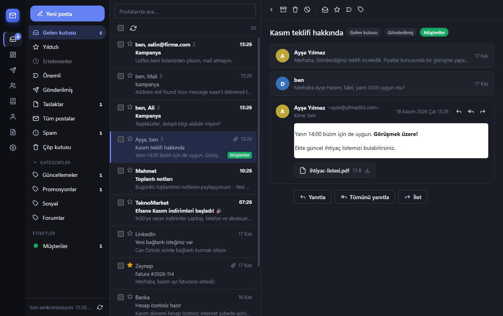

  

<h1 align="center">GmailFlow</h1>

  Gmail hesabınızla kişiselleştirilmiş toplu e-posta gönderimi ve gelen kutusu yönetimi için masaüstü uygulaması. 
  <i>A desktop app for personalised bulk email and inbox management with your own Gmail account.</i>

  

---

## 🇹🇷 Türkçe

**GmailFlow**, Excel veya CSV listenizdeki kişilere kendi Gmail hesabınızdan **her birine ayrı ayrı** kişiselleştirilmiş e-posta göndermenizi sağlar. Alıcılar birbirini görmez (CC/BCC kullanılmaz).

**Neler yapar?**
- Excel/CSV'den veya yapıştırarak alıcı listesi oluşturur; geçersiz ve tekrar eden adresleri ayıklar.
- `{{ad}}`, `{{sirket}}` gibi değişkenlerle kişiselleştirilmiş konu ve mesaj hazırlar; dosya ekleri ekler.
- Gönderimi başlatır, duraklatır, devam ettirir; Gmail günlük limitlerine uyar.
- Aynı kişiye yanlışlıkla ikinci kez mail gitmesini engeller.
- Gelen kutusu, yıldızlı, taslaklar, gönderilmiş gibi klasörleriyle Gmail'i uygulama içinden kullanmanızı sağlar.
- Toplu gönderimlere gelen yanıtları ve geri dönen (bounce) mailleri otomatik takip eder.

**Gereksinimler**
- **Windows 10 / 11 (64 bit).** Masaüstü uygulaması şu an yalnızca Windows'ta çalışmaktadır.
- **Bir Gmail hesabı.** Uygulama Google OAuth ile **Gmail hesabınıza bağlanmalıdır**. Bunun için kendi Google Cloud projenizde ücretsiz bir OAuth istemcisi oluşturmanız gerekir; adımlar uygulamanın **Gmail hesabı** sayfasında anlatılır.

**Kurulum:** `GmailFlow-Setup-x64.exe` dosyasını çalıştırın, uygulamayı açın ve **Gmail hesabı** sayfasından hesabınızı bağlayın.

Postalarınız ve verileriniz yalnızca kendi bilgisayarınızda saklanır.

GmailFlow **geliştirmeye açıktır**; öneri, hata bildirimi ve katkılarınızı bekliyoruz. Teknik ayrıntılar ve geliştirme ortamı için: [docs/TEKNIK.md](docs/TEKNIK.md).

---

## 🇬🇧 English

**GmailFlow** lets you send personalised emails from your own Gmail account to the people in an Excel or CSV list, **one separate email per recipient**. Recipients never see each other (no CC/BCC).

**What it does**
- Builds recipient lists from Excel/CSV or pasted text and removes invalid and duplicate addresses.
- Personalises subject and message with variables like `{{name}}` and `{{company}}`; supports attachments.
- Starts, pauses and resumes sending while respecting Gmail's daily limits.
- Prevents the same person from accidentally being emailed twice.
- Lets you use Gmail inside the app: Inbox, Starred, Drafts, Sent and more.
- Automatically tracks replies and bounces for your bulk sends.

**Requirements**
- **Windows 10 / 11 (64-bit).** The desktop app currently runs on Windows only.
- **A Gmail account.** The app **must be connected to your Gmail account** via Google OAuth. This requires a free OAuth client in your own Google Cloud project; the steps are explained on the app's **Gmail account** page.

**Installation:** run `GmailFlow-Setup-x64.exe`, open the app and connect your account on the **Gmail account** page.

Your mail and data are stored only on your own computer.

GmailFlow is **open to further development**; suggestions, bug reports and contributions are welcome. For technical details and the development setup see [docs/TEKNIK.md](docs/TEKNIK.md) (Turkish).
